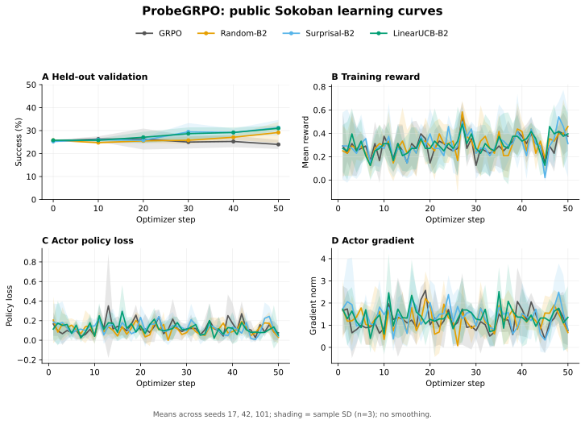
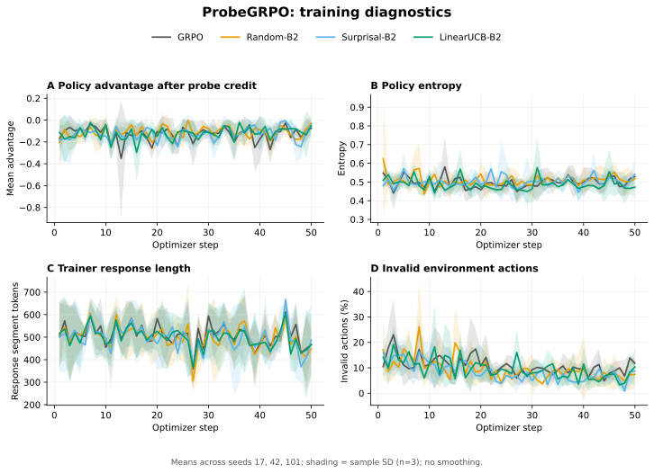
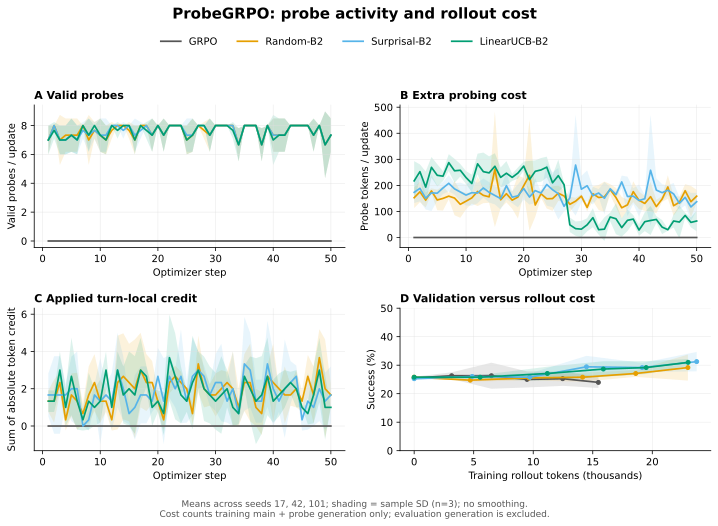
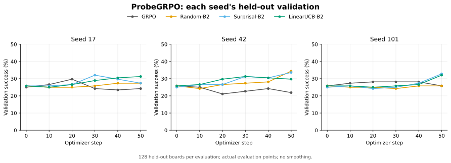

# 原始三种子实验的训练曲线

2026-10-13 从原实验机恢复四种方法 × 三个种子的原始训练日志和 episode sidecar，提取为本目录的逐步数据。没有重新训练模型。每个 run 含 50 次 optimizer update，以及 step 0、10、20、30、40、50 的验证；每次验证使用原来的 128 个 held-out boards。

导出时检查了训练 step 的完整性；绘图时逐一核对 12 个 run 的最终成功率、验证样本数、总 probe token 数，均与上一级 `per_seed.csv` 完全一致。失败的 `random_b2.failed-padding` 和早期未完成的 run 没有进入本次对比。

## 图表

### 学习曲线



### 训练诊断



### Probe 与成本



### 逐种子验证



每套图均有同名 PNG、SVG 和 PDF，位于 `docs/assets/public_sokoban_training/`。主对比线为三个种子的均值，阴影是样本标准差（n=3），不是置信区间；逐种子图直接显示每个原始验证点。没有平滑、插值新增数据点或挑选种子。线段只连接已观测的点。

## 数据与统计口径

- `per_step.csv`：12 × 51 = 612 行，包含训练/验证指标和从 episode sidecar 汇总的动作与 token 成本。CSV 中成功率采用 0–1，图中采用百分比。
- `mean_sd_by_step.csv`：按方法、指标和实际 step 对齐，只有三个种子均有该指标时才计算均值和 sample SD。
- `provenance.json`：原始 run 路径、log/manifest SHA-256、导出指标 CSV 的 SHA-256、导出时间和核对记录。
- 原始完整日志与 manifest 已下载到本项目 ignored `outputs/remote-training-history-20261013/`；大型 episode JSON 保留在远端。旧主实验关闭了 checkpoint 保存，不能把早期 GPU gate 的 checkpoint 当作这 12 组的最终模型。
- `critic/advantages/mean` 是 trainer 在 probe 接入后记录的 policy advantage，不能一概称为修改前的原始 GRPO advantage。
- `response_length/mean` 按 trainer 的 response segment 长度记录，在多轮 AgentLoop 中包含 observation 等上下文 token；它不等于仅 assistant 生成的 token 数。生成成本单独由 sidecar 的 `generated_token_ids` 计数。
- `cumulative_rollout_tokens` 只累计训练主 rollout 与额外 probe 的生成 token，不包含验证生成、prompt、log-prob forward 或所有 GPU 开销。成本图只能支持此定义下的比较。
- `cumulative_update_seconds` 累计原日志的 `timing_s/step`，不是重新测量的全程 wall time。

原实验的限制仍然适用，尤其是 seed 17 GRPO 先于 PPO mini-batch padding 修复完成。详见上一级结果记录的 Evidence boundaries；恢复训练曲线没有消除这些协议差异，也没有增加统计显著性的证据。

## 重画

在安装了 Matplotlib 的 Python 中运行：

```bash
make curves
```

本机这次使用独立环境中的 Matplotlib 3.10.7：

```bash
make curves PLOT_PYTHON=outputs/plotting-env/bin/python
```

该命令只读取已保存的 `per_step.csv` 和最终结果 reference，不需要 SSH、PyTorch、模型或原始轨迹。核心 CPU smoke 仍然不需要绘图依赖。

## SwanLab

远端已安装 SwanLab 0.10.2，原生 verl logger 已做独立的离线接口检查。12 个历史 run 已导入 `outputs/swanlab-history-20261013-v1/`，每个实验名以 `historical-public-sokoban-` 开头，保留原始 seed、method、训练配置和日志哈希；导入时关闭了当前硬件/运行环境采集，避免把今天的导入环境当成历史训练环境。

全部 12 个历史实验已同步到 [SwanLab ProbeGRPO 项目](https://swanlab.cn/@brwjf4y9hz-collab/probegrpo)。云端核对记录见 `swanlab_cloud_receipt.json`；后续实时训练入口与同步方式见 [SwanLab runbook](../../../../docs/SWANLAB_AND_CURVES_ZH.md)。
